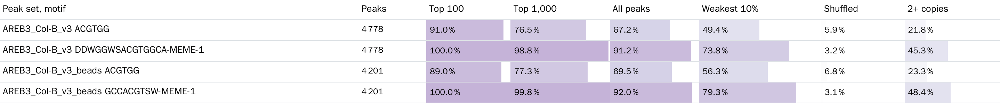
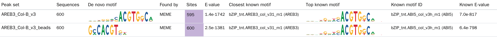
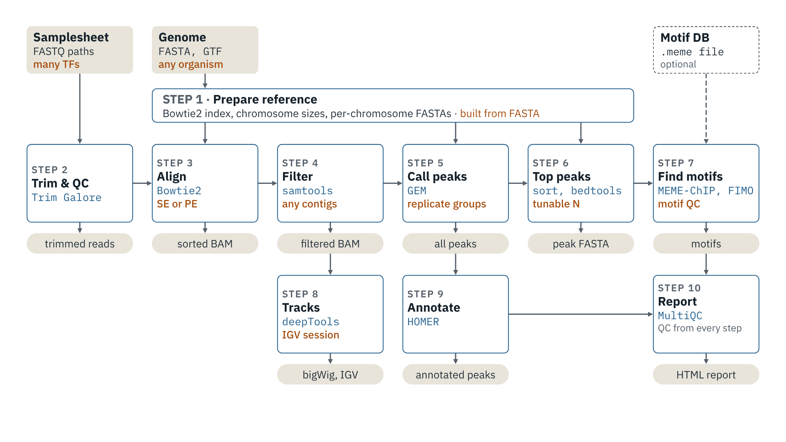

# DAP-Seq

A simple Nextflow pipeline for DAP-seq (DNA affinity purification sequencing) data from any organism: from FASTQ files to peaks, de novo motifs, gene annotation, genome browser tracks and a MultiQC report.

Adapted from the scripts in [hlab1/dap-seq-analysis](https://github.com/hlab1/dap-seq-analysis), extended with paired-end reads, replicate groups, motif QC and reporting.

## Example output

Two tables from the MultiQC report for the example in `example/`: public *Arabidopsis* AREB3 reads, run without a control (`AREB3_Col-B_v3`) and with a beads control (`AREB3_Col-B_v3_beads`).

**Motif presence.** For each peak set and motif, the % of peaks with at least one match, from the strongest peaks to the weakest, next to the % in shuffled sequence (the chance level).



**MEME-ChIP motifs.** For each peak set, the most significant de novo motif in the top peaks, the known motif it most resembles, and the known motif most enriched at the peak centres.



[Reading the report](docs/READING_THE_REPORT.md) explains every row and column.

## What it does



- **Trim** adapters and low-quality bases (Trim Galore), with FastQC.
- **Align** to the genome (Bowtie2). The index is built from the FASTA if you don't provide one.
- **Filter** by mapping quality and, optionally, chromosome (samtools). Paired-end libraries keep only proper pairs in which both mates pass, then read 1 of each pair, because GEM would otherwise count each fragment twice.
- **Call peaks** per sample and, for replicate groups, once more on the pooled replicates (GEM).
- **Find motifs** in the top peaks (MEME-ChIP).
- **Check motifs** across all peaks against a shuffled background (FIMO).
- **Annotate** peaks to genes (HOMER).
- **Make tracks**: bigWig coverage (deepTools) and an IGV session.
- **Report** everything in one place (MultiQC).

## Requirements

- [Nextflow](https://www.nextflow.io/) 25.04 or later
- Singularity or Apptainer. Each tool runs from a pinned container, pulled on first use.

## Quick start

```bash
git clone https://github.com/gencorefacility/DAP-Seq.git
nextflow run DAP-Seq/main.nf -params-file params.yaml -profile singularity,slurm
```

Relative paths in the params file and samplesheet resolve from the directory you launch in. Leave out `slurm` to run on the local machine.

If your SLURM cluster requires an account, set it first:

```bash
export SBATCH_ACCOUNT=<your_account>
```

Add `-resume` to reuse finished steps after a change or a failure.

### Params file

```yaml
input: samplesheet.csv
fasta: genome.fa
gtf: genes.gtf
keep_chromosomes: "1,2,3,4,5"
memechip_db: motifs.meme
qc_motifs: ACGTGG
outdir: results
```

`example/` holds the settings for the AREB3 demo. Its reads are SRR2926843 (AREB3) and SRR2926068 (beads control, read 1 only), on the TAIR10 genome, with `ArabidopsisDAPv1.meme` from the [MEME motif databases](https://meme-suite.org/meme/db/motifs).

### Samplesheet

```csv
sample,fastq_1,fastq_2,control,group
TF1_rep1,TF1_rep1_R1.fastq.gz,TF1_rep1_R2.fastq.gz,Ctrl_rep1,TF1
TF1_rep2,TF1_rep2_R1.fastq.gz,TF1_rep2_R2.fastq.gz,Ctrl_rep2,TF1
Ctrl_rep1,Ctrl_rep1_R1.fastq.gz,Ctrl_rep1_R2.fastq.gz,,
Ctrl_rep2,Ctrl_rep2_R1.fastq.gz,Ctrl_rep2_R2.fastq.gz,,
```

| Column | Required | Meaning |
|---|---|---|
| `sample` | yes | Unique name |
| `fastq_1` | yes | Read 1, or the only read |
| `fastq_2` | no | Read 2. Leave empty for single-end |
| `control` | no | The `sample` name of the control row. Leave empty to run GEM without a control. Control rows are aligned but not peak-called |
| `group` | no | Replicates of one experiment share a group name. GEM runs on each replicate and once on the group, with all of its controls. Leave the column out if you have no replicates |

## Main parameters

| Parameter | Default | Meaning |
|---|---|---|
| `input` | required | Samplesheet CSV |
| `fasta` | required | Genome FASTA, plain or `.gz` |
| `gtf` | required | Gene models with the same contig names as the FASTA, plain or `.gz` |
| `outdir` | `results` | Output directory |
| `bowtie2_index` | none | Directory with a prebuilt index. If omitted, the index is built from `fasta` |
| `save_reference` | `false` | Save a built index to `<outdir>/genome/bowtie2_index`, to reuse as `bowtie2_index` in later runs |
| `min_mapq` | `30` | Minimum mapping quality |
| `keep_chromosomes` | all | Chromosomes to keep, such as `"1,2,3,4,5"` |
| `top_n_peaks` | `600` | Peaks given to MEME-ChIP. Annotation and motif QC use all peaks |
| `memechip_db` | none | Known-motif database for MEME-ChIP, in MEME format |
| `qc_motifs` | none | Motifs to check in all peaks: IUPAC strings and/or MEME files |
| `qc_motifs_n_denovo` | `1` | Top MEME-ChIP motifs to add to the motif check |
| `gem_threads` | `1` | More than 1 is faster, but results are not reproducible: thread timing changes the order of events going into GEM's motif step |
| `gem_args`, `trim_args`, `bowtie2_args`, `memechip_args`, `bigwig_args` | empty | Extra arguments, passed to the tool as written |

`nextflow.config` lists the rest.

## Output

| Directory | Contents |
|---|---|
| `multiqc/` | `multiqc_report.html`: start here |
| `gem/` | Peaks per peak set: GEM events as narrowPeak, BED and text, plus GEM's log |
| `top_peaks/` | Top peaks and their sequences |
| `meme_chip/` | Full MEME-ChIP results per peak set |
| `motif_qc/` | Motif presence per peak set, and every peak's matches (`<peak set>.motif_peaks.tsv`) |
| `annotation/` | Peaks with their nearest genes |
| `bigwig/`, `igv/` | Coverage tracks and `igv_session.xml` |
| `bam/`, `samtools/` | Unfiltered and filtered BAMs, alignment statistics |
| `trim_galore/`, `bowtie2/` | Trimming reports, FastQC and alignment logs |
| `pipeline_info/` | Nextflow run report, timeline and trace |

## Notes

- **GEM license:** GEM's license is research use only, so check that its terms cover your use.
- **Few peaks:** GEM 3.3 needs about 500 significant events to re-learn its read shape, and can crash below that. For weak samples, try `gem_args: "--min 300"`.
